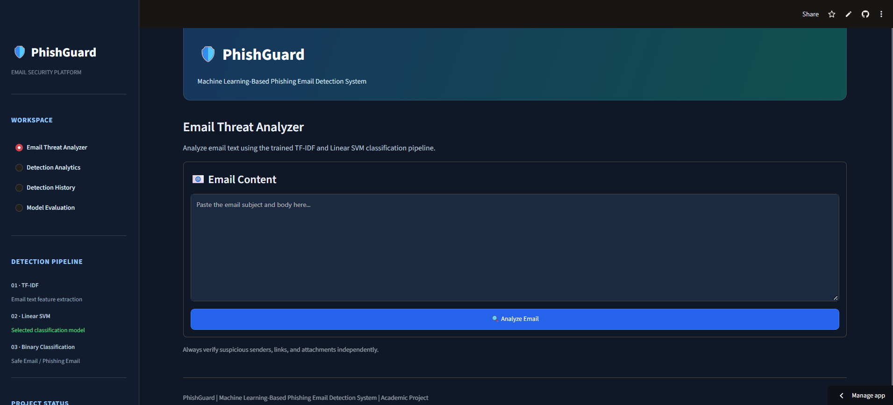
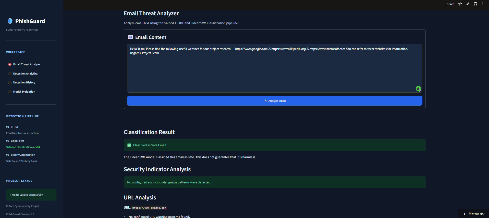
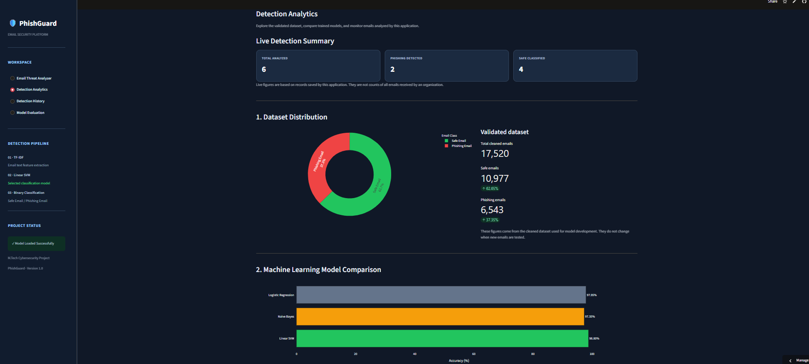
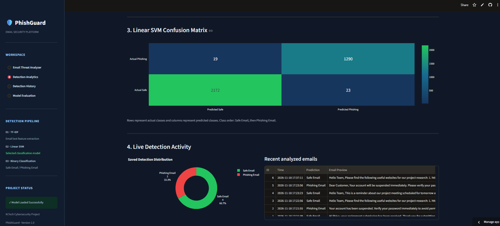
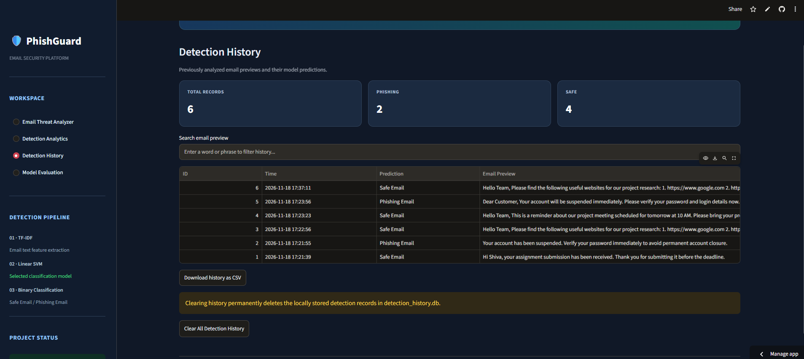
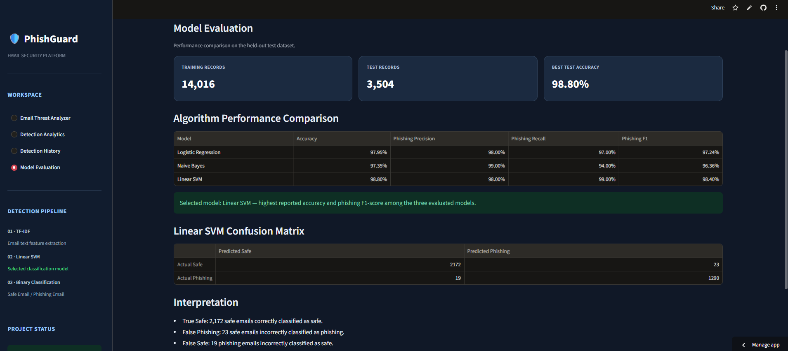

# 🛡️ PhishGuard – Machine Learning-Based Phishing Email Detection System

PhishGuard is a machine learning-based phishing email detection system that analyzes email text and classifies it as either **Safe Email** or **Phishing Email**.

The project uses TF-IDF for text feature extraction and compares multiple traditional machine learning algorithms to identify the best-performing classification model. A Streamlit dashboard provides an interactive interface for email analysis, detection analytics, detection history, and model evaluation.

## 🚀 Live Application

[Open PhishGuard Dashboard](https://phishing-email-detection-kqn2raewjs6uyz8s6yddt.streamlit.app/)

## 📌 Project Objectives

- Develop a machine learning system for phishing email text classification.
- Preprocess and clean email text data.
- Extract text features using TF-IDF.
- Compare multiple machine learning algorithms.
- Evaluate model performance using standard classification metrics.
- Develop an interactive Streamlit dashboard.

## 🧰 Technologies Used

| Technology | Purpose |
|---|---|
| Python | Programming language |
| Pandas | Dataset processing |
| Scikit-learn | Machine learning and evaluation |
| TF-IDF | Text feature extraction |
| Logistic Regression | Classification |
| Multinomial Naive Bayes | Classification |
| Linear SVM | Classification |
| Joblib | Model serialization |
| Streamlit | Web application |
| Plotly | Interactive visualizations |
| SQLite | Local detection history |

## 📂 Project Structure

```text
Phishing-Email-Detection/
│
├── app.py
├── main.py
├── security_analysis.py
├── requirements.txt
├── .gitignore
│
├── models/
│   └── best_model.pkl
│
├── src/
│   ├── clean_dataset.py
│   ├── explore_dataset.py
│   ├── validate_dataset.py
│   ├── train_model.py
│   └── test_model.py
│
├── research/
│   └── dataset_analysis.md
│
└── docs/
    ├── results.md
    └── screenshots/
        ├── dashboard.png
        ├── email_analyzer.png
        ├── detection_analytics-01.png
        ├── detection_analytics-02.png
        ├── detection_history.png
        └── model_evaluation.png
```

## 🧹 Dataset and Preprocessing

The project uses an email text classification dataset containing two categories:

- Safe Email
- Phishing Email

After preprocessing and cleaning:

| Description | Records |
|---|---:|
| Original records | 18,650 |
| Cleaned records | 17,520 |
| Safe Emails | 10,977 |
| Phishing Emails | 6,543 |

The cleaned dataset was divided into:

- Training set: 14,016 records (80%)
- Testing set: 3,504 records (20%)

## ⚙️ Methodology

The system follows these stages:

1. Dataset Collection
2. Data Cleaning and Preprocessing
3. Text Feature Extraction using TF-IDF
4. Machine Learning Model Training
5. Model Performance Evaluation
6. Best Model Selection
7. Streamlit Application Development
8. Email Text Prediction

## 🤖 Machine Learning Models

Three classification algorithms were evaluated:

1. Logistic Regression
2. Multinomial Naive Bayes
3. Linear Support Vector Machine (Linear SVM)

Linear SVM was selected as the final model based on its highest recorded test accuracy and phishing F1-score.

## 📊 Experimental Results

| Model | Accuracy | Phishing Precision | Phishing Recall | Phishing F1-score |
|---|---:|---:|---:|---:|
| Logistic Regression | 97.95% | 98% | 97% | 97.24% |
| Multinomial Naive Bayes | 97.35% | 99% | 94% | 96.36% |
| Linear SVM | **98.80%** | 98% | 99% | **98.40%** |

### Linear SVM Confusion Matrix

| Actual Class | Predicted Safe | Predicted Phishing |
|---|---:|---:|
| Safe Email | 2,172 | 23 |
| Phishing Email | 19 | 1,290 |

These results represent the evaluated held-out test dataset and do not guarantee equivalent performance on unseen real-world emails.

## 🖥️ Application Screenshots

### 1. Dashboard



### 2. Email Threat Analyzer



### 3. Detection Analytics





### 4. Detection History



### 5. Model Evaluation



## 💻 Installation and Execution

### 1. Clone the repository

```bash
git clone https://github.com/chShiva19/Phishing-Email-Detection.git
cd Phishing-Email-Detection
```

### 2. Create a virtual environment

```bash
python -m venv .venv
```

### 3. Activate the environment

Windows PowerShell:

```powershell
.venv\Scripts\Activate.ps1
```

### 4. Install dependencies

```bash
pip install -r requirements.txt
```

### 5. Run the Streamlit application

```bash
streamlit run app.py
```

The application will open in your browser.

## 📈 Dashboard Features

- **Email Threat Analyzer:** Classifies email text as Safe or Phishing.
- **Detection Analytics:** Displays detection distribution and analytics.
- **Detection History:** Stores and displays analyzed email records with CSV export.
- **Model Evaluation:** Displays algorithm comparison, performance metrics, and confusion matrix.

## ⚠️ Limitations

- The current model analyzes email text only.
- It does not independently inspect sender identity, email headers, attachments, or embedded URLs.
- Model performance may differ on unseen real-world emails.
- Local SQLite history on cloud hosting is not guaranteed to persist across restarts or redeployments.

## 🔮 Future Enhancements

- Email header and sender reputation analysis.
- URL and attachment threat analysis.
- Integration with email security workflows.
- Evaluation on larger and more diverse real-world datasets.
- Persistent cloud database integration.
- Advanced NLP-based classification techniques.

## 🎓 Project Information

**Project Name:** PhishGuard – Machine Learning-Based Phishing Email Detection System

**Domain:** Cybersecurity and Machine Learning

**Application:** Streamlit Web Application

**Model:** Linear Support Vector Machine (Linear SVM)

---

**PhishGuard – Building a smarter approach to phishing email detection.**